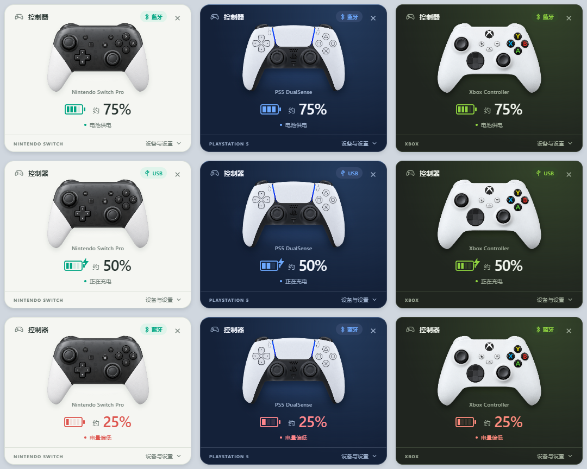

# 手柄电量看板 3.0

Windows 10 22H2 / Windows 11 x64 桌面悬浮看板。Tauri 2、React、TypeScript、Vite、CSS Modules；硬件与连接会话为 Rust，使用 windows-rs 的 Win32 绑定和 XInput。正式程序没有 .NET/C# 辅助进程，前端与图片均本地打包。

下图使用模拟数据，展示三种手柄主题及电量状态：

## 构建

需要 Node.js 24 LTS、Rust stable MSVC x64、Microsoft C++ 构建工具及 Windows SDK。运行 `./build.ps1` 安装锁定依赖、执行检查并生成 NSIS x64 离线安装包。`buildenv.ps1` 优先使用本工作区便携工具；不存在时使用系统已有工具。安装包输出在 `target/release/bundle/nsis/`。

手动命令：`npm ci`、`npm test`、`cargo test --workspace --locked`、`npm run tauri build -- --bundles nsis`。`npm run tauri dev` 用于开发。

## 结构

- `crates/propad-core`：协议、电量、型号、设备选择和连接会话；133 项回归检查。
- `crates/propad-hardware`：Windows HID、CM 通知、蓝牙在线检查、共享异步读写、XInput；后台 I/O 与旧线程代际隔离。
- `src-tauri`：窗口、托盘、自启动、单实例、设置升级、安装器和受限前端命令。
- `src`：三家主题、Canvas 手柄图片联动、前端帧顺序控制与模拟数据。

## 诊断和模拟

运行 EXE 时使用 `--demo=switchPro`、`--demo=xbox` 或 `--demo=dualSense`，另加 `--state=charging|full|low|unknown|wired|stale|reading|disconnected|controls`。模拟使用独立实例与设置目录，不打开手柄。

浏览器开发预览支持 `?demo=switchPro&state=charging&expanded=1`，仅非 Tauri 环境启用模拟。正式 Tauri 模式使用 Rust 状态，不采用浏览器演示数据。

本机诊断：`ProPadDashboard.exe --command=status --output 路径.json`。命令包括 `show`、`hide`、`expand`、`collapse`、`input-status`、`input-reset`、`resume`、`select:设备ID` 和 `exit`。诊断管道仅当前用户和系统可访问；输入覆盖统计仅在内存中，不记录按键事件日志。`--no-startup` 供独立检查时禁用启动项修改。

## 兼容边界

Switch Pro 057e:2009；DualSense 054c:0ce6、Edge 054c:0df2；Xbox 使用系统 XInput。默认发现全部受支持设备，不按固定蓝牙地址过滤。

Xbox 电量为系统档位，USB 无电量时显示外部供电与破折号；不能可靠区分真实 Xbox 与 Steam 创建的虚拟 Xbox，Guide 可选、Share 不保证。DualSense 触摸板支持按下，未实现手指轨迹、自适应扳机、灯光或振动控制。同一 Switch/DualSense 的 USB/蓝牙合并依赖有效地址；XInput 设备按槽位识别。

独占全屏不保证覆盖。Windows 11、Xbox 和 DualSense 的实体测试范围以随包测试记录为准。

## 升级与回退

NSIS 当前用户安装默认沿用 `%LOCALAPPDATA%/ProPadDashboard`，升级前通过旧版命名管道安全退出，备份 v2 程序及设置到 `backup-v2`，迁移登录启动选择。旧设置固定 `TargetAddress` 被忽略，绝不会作为发现白名单。设置文件使用版本3和原子替换；损坏设置不影响程序启动。

后续安装器升级使用 `/UPDATE`；普通卸载会移除本程序的登录启动项并保留设置和备份。

参考：<https://v2.tauri.app/>、<https://github.com/libsdl-org/SDL/blob/main/src/joystick/hidapi/SDL_hidapi_switch.c>、<https://github.com/libsdl-org/SDL/blob/main/src/joystick/hidapi/SDL_hidapi_ps5.c>。
